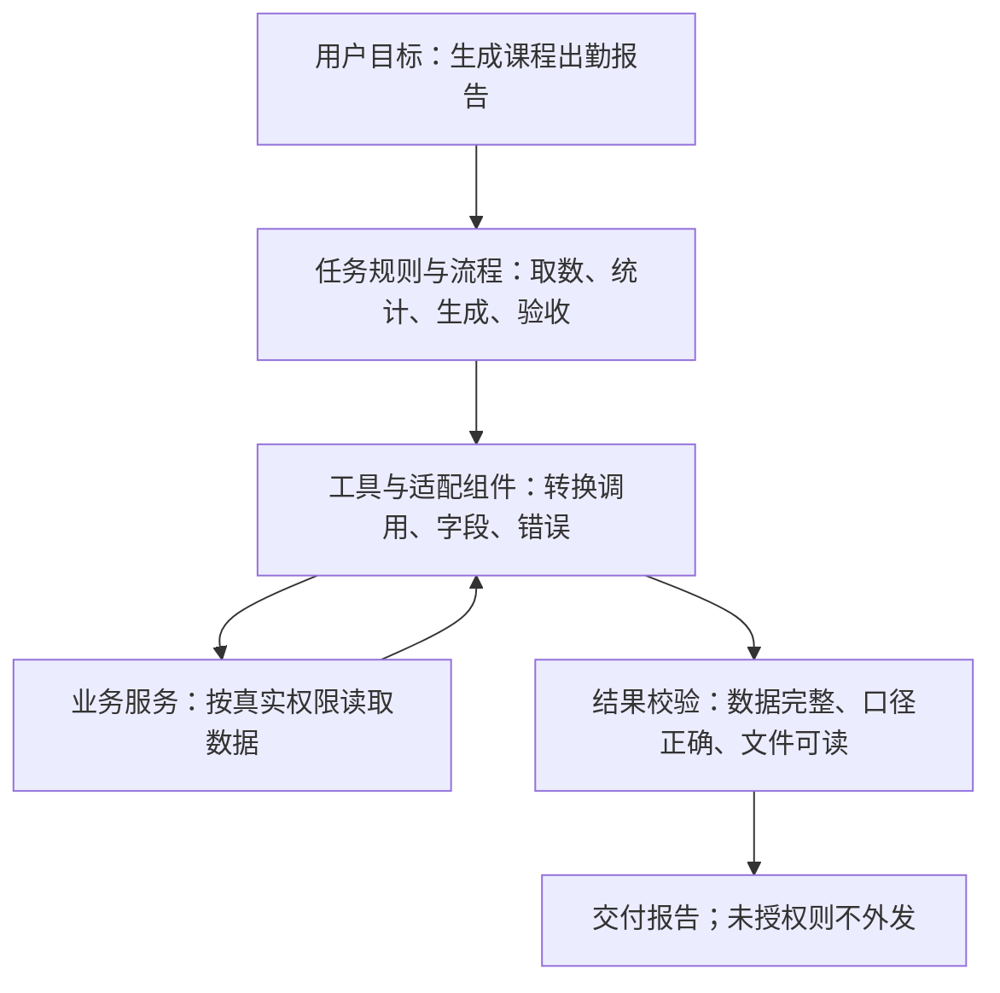

# 协议适配与任务适配：接通接口和完成业务

## 一句话解释

**协议适配主要解决“不同系统怎样按双方支持的规则交换请求与结果”；任务适配主要解决“怎样把通用能力调整、组织成适合某个具体业务目标的做法”。**

可以先记成：**协议适配让系统接得上、信息传得对；任务适配让能力用得合适、结果达到要求。**

> [!note] 先确定语境
> “协议适配”和“任务适配”不是所有领域都采用相同定义的一对正式分类。本文主要按软件集成与智能体应用工程解释。实践中有人把接口格式转换也宽泛称为协议适配；机器学习论文里的任务适配还可能涉及训练。遇到具体文章，应结合其原文判断。

## 生活类比：翻译与办事方案

假设你请一位助理联系国外酒店：

- 对方使用另一种语言和订房表格。把你的信息翻译成对方接受的表达，再把回复转换回来，类似协议或接口适配。
- 决定住哪天、需要几间房、预算多少、是否需要无障碍设施，以及是否先征求你确认，类似任务适配。

翻译准确，不代表订房方案符合你的需求；方案再好，消息发不出去、返回内容读不懂，也无法完成任务。

这只是职责类比，真实适配代码往往还要处理数据校验、权限和失败情况。

## 1. 协议、接口和适配器先分别是什么意思

**协议（Protocol）**是参与方通信时遵守的约定，例如消息怎么组织、怎样请求、怎样响应和怎样表示错误。

**API = Application Programming Interface，应用程序编程接口，逐字母读 A-P-I。**它规定软件向其他程序开放哪些操作，以及参数、结果等调用约定；接口不一定经过网络。

**Adapter（适配器）**是起衔接作用的组件，读音近似“阿达普特”。它通常把调用方的请求转换为被调用方能接受的形式，再把结果转换回来。它可以只是一个函数或库，也可以是服务中的模块，不一定要单独部署一台服务器。

### 严格的协议转换与接口适配，不完全是一回事

例如，两个系统都使用 HTTP，即 **Hypertext Transfer Protocol，超文本传输协议，逐字母读 H-T-T-P**，仍可能有不同的接口路径、字段、认证方法和返回格式。

把这些差异统一起来，严格说可能主要是在做 **API 适配、数据映射或格式转换**，并没有更换底层 HTTP 协议。

如果参与方使用的消息交换协议本身不同，还要转换相应的协议交互规则，才是更严格意义上的协议转换。

因此，听到“协议适配”，应追问：**到底适配的是通信协议、接口约定、数据格式，还是三者都有？**参见 [[SDK与API]]。

## 2. 协议或接口适配通常做什么

| 要处理的差异 | 通俗解释 | 例子 |
|---|---|---|
| 请求方式 | 对方要求怎样调用 | 把统一的函数调用转换成对应服务请求 |
| 数据字段与类型 | 信息应放在哪里、长什么样 | 内部参数是字符串，对方要求特定格式的课程编号 |
| 身份认证 | 怎样证明调用方有资格访问 | 按目标服务要求携带合法凭据，而不是绕过认证 |
| 结果与错误 | 怎样读懂成功、失败和处理中 | 把服务的错误结果转换成调用方可识别的错误 |
| 交互方式 | 是一次返回，还是持续返回 | 适配分段输出、结束标记或取消请求的约定 |
| 版本与能力 | 双方支持哪些功能 | 明确某版本是否支持某种输入或工具调用 |

它不只是“改几个字段名”。例如把“请求已受理”误转成“任务已完成”，即使消息能收发，适配仍然是错的。

同样，字段都叫 `id` 不代表属于同一个编号体系；字段都叫“时长”也不代表单位相同。映射必须有文档或可信数据依据。

### 模型服务之间的适配

应用想用统一方式发送问题，但模型服务 A 和 B 的请求、返回和流式事件可能不同。模型适配器可以把这些差异封装起来，让应用调用方式相对一致。

例如 LangChain 提供标准模型接口，并连接不同供应商实现。[LangChain 模型文档](https://docs.langchain.com/oss/python/langchain/models)

但统一调用方式不意味着模型能力相同：输入限制、工具调用、图像处理、结构化输出及效果仍要分别确认。**改好请求格式，不会自动让一个模型获得它本来没有的能力。**

### 接模型接口，只填地址和协议就可以了吗

**如果所用平台已经做好对应适配，使用者通常不用亲自写底层请求和解析代码；但这叫“由平台封装处理”，不是“接口和协议可以完全不管”。**

生活类比：插上显示器时，不必自己实现信号传输，但仍要选对接口和设备支持的功能；转换头不能凭空增加设备本来没有的能力。

常见的模型接入配置有：

| 配置项 | 含义 | 通常从哪里获得 |
|---|---|---|
| 服务商或接口类型 | 让客户端选择对应的请求与返回处理方式 | 平台支持列表、服务商接入文档 |
| Base URL（基础地址） | 模型服务的入口，软件可能在它后面追加操作路径 | 实际服务提供方的文档 |
| API Key（接口密钥）或其他凭据 | 用于身份验证及关联权限、计费等 | 对应服务的账户控制台或授权流程 |
| 模型标识 | 指定要调用的模型或部署 | 服务商文档或账户可用模型列表 |
| 其他必要选项 | 例如版本、区域、部署名称或功能参数 | 取决于服务和平台，不能一概省略 |

URL = Uniform Resource Locator，统一资源定位符，逐字母读 U-R-L；日常可理解为资源地址。Base URL 与“某个具体操作的完整地址”不是必然相同：有的软件要求前者，有的要求后者，应按它的说明填写，不能随意把路径重复拼接。

有的平台已经代管凭据或默认地址，不需要用户逐项填写；有的云服务也不是使用单一 API Key。上表是常见配置，不是所有产品的必填表单。

**界面中的“协议”含义也要看具体选项。**如果选项是模型接口风格或兼容格式，它通常在选择适配器；这与地址中的 HTTP 或 HTTPS 不是同一层含义。HTTPS = Hypertext Transfer Protocol Secure，安全超文本传输协议，逐字母读 H-T-T-P-S，用来保护网络传输；同样使用 HTTPS，并不说明两家的模型请求格式一致。

DeepSeek 官方接入文档就列出了基础地址、接口密钥和模型标识，并说明可以借助兼容的客户端或工具包接入。这能解释为何某些成熟软件看起来只需要配置几个选项。[DeepSeek 官方接入说明](https://api-docs.deepseek.com/)

### 这些东西是谁提供、谁负责的

SDK = Software Development Kit，软件开发工具包，逐字母读 S-D-K。它可以封装认证、请求和解析，但工具包既可能来自服务商，也可能来自框架维护者或第三方。

| 角色 | 通常负责什么 | 不能据此推断什么 |
|---|---|---|
| 模型或推理服务提供方 | 提供服务入口、接口文档、参数规则、认证方式与服务限制 | 自动理解你公司的业务规则 |
| 应用平台、框架或适配插件维护者 | 把具体接口接到统一界面，处理请求、返回和所支持的能力差异 | 所有接口版本和模型功能都完全兼容 |
| 应用开发及运维团队 | 正确配置和集成，保护凭据，处理错误、超时、限流、版本变化并测试 | 只要能返回一句话，就可以直接投入全部业务 |
| 业务负责人或产品团队 | 定义任务目标、数据范围、规则、权限、验收和风险取舍 | 必须亲自实现底层协议或所有代码 |

这些角色可以由同一家公司或同一团队承担。这里是职责划分，不是固定的组织结构。

“官方提供”也要分清：

- 直连模型厂商自己的服务时，其官方文档是接入规则的重要依据。
- 如果调用的是云平台、代理网关或其他服务商，地址、凭据及具体限制要以实际服务方为准，模型开发者和接口运营方未必是同一方。
- 通用通信协议不一定由模型厂商发明；厂商是在相关标准之上实现自己的服务接口。
- 标注“兼容某接口风格”，不代表它就是那个接口风格所属厂商的官方服务，也不代表所有功能都支持。

LangChain 的标准模型接口与供应商集成就是由框架帮助处理部分差异的例子；其文档仍要求分别关注模型供应商的能力。[标准模型接口说明](https://docs.langchain.com/oss/python/langchain/models)

### 作为业务使用者，至少还要关心哪些事

你可以不亲自编写请求代码，但至少应确认：

1. **请求发给谁**：地址是否可信，业务数据会被哪家实际服务处理；模型叫什么不能替代这个检查。
2. **凭据是否放对地方**：不要把密钥发到聊天里、写进公开仓库，或直接放进公开网页的前端代码；应交给适当的受控配置或密钥管理机制。
3. **所需功能是否真的可用**：能普通聊天，不代表图片输入、工具调用、流式输出等都验证通过。
4. **失败时怎么办**：限流、超时、账户权限或额度问题，应有明确处理和提示，不能无限重试。
5. **更换后是否仍适用**：换模型、地址或接口版本后，要重新验证依赖的能力及业务结果。

如果自己写程序直接调用接口，就需要由开发者处理更多细节，而不仅是填写配置。使用现成平台的业务用户可以把这些技术验收交给团队，但不能将“有人封装了”误认为“无人需要负责”。

## 3. 任务适配：围绕目标调整能力、规则和执行方式

在本文的应用工程语境里，任务适配指把通用软件或智能体调整为能处理某类具体任务的系统。它可以包含提示词、数据、工具、流程、权限和验收标准的组合，不等于必须训练模型。

Agent 指智能体，也就是可以围绕目标调用工具并根据结果继续工作的系统。一个通用智能体即使“能查数据、能写文字”，也未必知道你的出勤率计算规则。

假设要求是：

> 统计指定课程的出勤情况，生成一份只供内部查看的报告，不发送给学员。

需要明确的问题包括：

1. **目标是什么**：统计人数、有效观看时长，还是课程完成率？
2. **输入是什么**：哪门课程、哪个时间范围、哪些数据来源？
3. **业务口径是什么**：观看多久算出勤？断线重连是否合并？同一人重复进入怎么处理？
4. **需要哪些能力**：查课程、取观看记录、统计、生成文件。
5. **怎么组织步骤**：先取完整数据，再去重统计，最后生成报告。
6. **什么不能做**：不能读取无关学员数据，不能自动给学员发消息。
7. **怎样算完成**：报告文件存在、数字可核对、权限符合要求，而不是仅仅生成了一段“已完成”的回复。

这些才是把通用能力应用到具体业务时需要解决的事。任务流程可以由普通程序、工作流或智能体组织，不一定需要多个模型或多个智能体。

工作流可以使用预定义代码路径，智能体也可以在限定范围内动态选择行动；这是两种可组合的组织方式。[LangGraph 工作流与智能体说明](https://docs.langchain.com/oss/python/langgraph/workflows-agents)

关联 [[LangGraph：有状态工作流与LangChain的区别]]、[[Agent Harness：模型之外的运行系统]]。

### 任务适配需要我们来管吗

**通常需要你们的团队负责，但不是说你本人必须写代码。业务方主要定义要求与边界，开发者或平台配置人员把它落实为可执行、可验证的流程。**

例如“生成课程出勤报告”：

- 你们决定：哪些课程纳入统计、什么算有效出勤、哪些数据不能外发、报告给谁看、什么结果能验收。
- 开发者实现：身份和权限检查、观看记录读取、重叠时段处理、统计函数、报告生成与结果核验。
- 模型承担适合它的部分：例如理解用户查询、解释已核实的统计结果、整理文字；不应让它凭猜测决定确定性的统计口径或绕过程序权限。

成熟业务产品或现成工作流模板可能已经做好一部分任务适配。此时可以主要做配置和验收，不必全部重写；但仍要确认它的默认规则适合你们，不能把模板默认值直接当成业务决定。

因此更准确的理解是：**接口适配经常能够复用；任务适配更贴近你的业务，通常需要你们确认并落实。两者都可以借助现成工具，但两者都不能没有责任人。**

## 4. 用同一份课程数据，看两者分别做什么

以下字段和数据都是教学假设，不是实际平台接口。

某个数据服务返回：

```json
{
  "learner_code": "u17",
  "watch_seconds": 1800
}
```

JSON = JavaScript Object Notation，JavaScript 对象表示法，读音近似“杰森”；它是一种组织字段和值的文本格式。

假设双方已经确认：`learner_code` 就是内部采用的学员编号，`watch_seconds` 的单位确实为秒。数据适配组件可以把它转换为内部统一形式：

```json
{
  "student_id": "u17",
  "watch_minutes": 30
}
```

这两段数据表达的是同一条观看记录。这里主要是**数据与接口适配**：统一字段，并依据已确认的单位把 1800 秒换算为 30 分钟，不一定涉及更换通信协议。

任务适配要进一步处理的是：

- 业务若规定“有效观看达到 30 分钟才算出勤”，这条记录是否满足？
- 这个数字是否已处理重复会话、重连与重叠时段？
- 是否取齐了该课程全部相关记录，还是只取到了第一页？
- 这条记录怎样计入报告，报告应该交给谁？

**把秒换成分钟，不等于已经定义了什么算出勤；把一页记录读出来，也不等于完成整门课程的统计。**

有的系统把分页、去重或业务统计封装在工具内部，有的放在工作流中。责任边界取决于接口契约与系统设计，不是看到某个动作就能唯一归入某一层。

## 5. MCP、SDK、工作流和 Harness 分别处在哪里

MCP = Model Context Protocol，模型上下文协议，逐字母读 M-C-P。它让应用与提供工具、资料等能力的服务使用标准化接口交互。

例如，应用通过 MCP 发现和调用“查询课程观看记录”的工具，工具所在的服务再访问内部业务接口。这层衔接可以包含协议与接口适配。[MCP 服务端概念](https://modelcontextprotocol.io/docs/learn/server-concepts)

但 MCP 本身不会替你的业务决定“看多久算出勤”“谁能收到报告”。官方架构说明明确区分了协议交换与应用如何使用模型、管理上下文。[MCP 架构说明](https://modelcontextprotocol.io/docs/learn/architecture)

SDK = Software Development Kit，软件开发工具包，逐字母读 S-D-K。它可以帮你处理请求、解析等细节，但安装工具包不等于完成了业务设计。

Harness 指围绕模型的运行支撑系统；工作流、任务状态、工具和校验规则可以在其中协作。Skill（技能）在智能体产品中也可能承载某类任务的步骤和资料，但其具体机制因产品而异，不能仅凭名称认定已经有可靠的执行和权限控制。



这是职责示意，不要求每一框都是独立服务，也不是所有任务都必须使用 MCP。

**“MCP 主要标准化接入”不意味着 MCP 工具不能承载业务。**一个工具完全可以封装整套统计流程；此时任务规则存在于工具实现中，而不是协议自动提供的。协议适配与任务适配也可能出现在同一个组件里。

## 6. 用一张表区分

| 对比点 | 协议或接口适配 | 任务适配（应用工程语境） |
|---|---|---|
| 主要目的 | 兼容双方通信与调用约定 | 让能力适用于具体业务目标 |
| 常见内容 | 参数、格式、认证衔接、错误、流式交互 | 业务规则、上下文、步骤、工具选择、验收 |
| 课程报告例子 | 正确调用记录接口并读懂返回数据 | 按正确口径统计并生成合适的报告 |
| 失败表现 | 参数不被接受、字段读错、状态误判 | 课程选错、统计口径错、漏步骤、越权外发 |
| 成功证据 | 请求与返回符合契约，错误不被掩盖 | 最终结果满足业务要求且没有越权副作用 |
| 单独不能保证 | 业务正确、模型能力和使用权限齐全 | 底层服务可达、接口兼容、外部能力存在 |

这里“符合契约”指符合双方已约定的调用规则，不是法律合同。

## 7. 常见误区和安全边界

### 接通接口，就完成任务了吗

没有。能成功获取观看记录，不等于统计了正确课程，更不等于计算了正确的出勤率。类似地，[[全量测试、回归测试与测试分层#冒烟测试详解|冒烟检查]]中工具连通通过，不能代替完整业务验收。

### 任务适配就是写一句提示词吗

不是。提示词可以表达要求，但重要规则还可能需要程序、真实权限、数据校验和状态管理共同保证。参见 [[Prompt Engineering与Loop Engineering]]、[[Agent可靠性术语辨析：上下文、状态、反馈、路由与记忆]]。

### 统一协议可以绕过权限，或者复制所有能力吗

不可以。适配组件只能使用合法获得且适用于目标服务的凭据；不能把认证字段改名就当作获得访问资格，也不能无条件转发凭据或无关数据。

目标系统没有某项能力时，需要明确报“不支持”，或者设计并验证替代实现；不能悄悄丢掉参数，再声称效果完全一致。系统能联网、接口能调用、用户授权操作，仍然是不同条件。

### 错误后直接重试，就更可靠吗

不一定。协议层和任务层若各自无限重试，可能叠加重复操作。尤其发送消息、生成订单等有外部影响的动作，应明确重试责任、查询实际状态并设计幂等机制，见 [[状态机与幂等性]]。

### 所有文章里的任务适配都指工作流吗

不是。在机器学习语境中，任务适配还可能指通过训练或微调，让预训练模型更适合分类等下游任务。例如研究中的 Adapter 可以是模型内部新增的可训练模块，与本文连接接口的软件适配器不是同一种东西。[Houlsby 等人的原始论文](https://proceedings.mlr.press/v97/houlsby19a.html)

因此要先区分：**是在适配模型内部能力，还是在模型外部组织应用流程？**本文重点是后者，不意味着所有任务适配都要改模型参数。

## 学习建议

遇到“已经完成适配”，可以追问：

1. 两边原来哪些约定不一致，现在转换了什么？
2. 哪些能力仍然不支持，是否会明确报错？
3. 这个任务的输入、规则、步骤和完成标准是什么？
4. 权限、敏感数据和重试由谁负责？
5. 测试证明的是“接口可用”，还是“任务真正做对”？

先读 [[SDK与API]]，再结合 [[MCP模型上下文协议]]、[[Agent Harness：模型之外的运行系统]] 和 [[LangGraph：有状态工作流与LangChain的区别]] 理解。工业设备的类似问题可参考 [[边缘计算模块与边缘网关]]。

## 参考资料与说明

核对日期：2026-10-26。以下资料支持文中的接口、协议、编排与模型适配机制，不表示“协议适配/任务适配”是这些项目统一规定的二分法。课程接口和数据仅为教学示例，本次没有接入或操作用户的业务系统。

- [MCP Architecture Overview](https://modelcontextprotocol.io/docs/learn/architecture)：协议范围与应用职责的区分。
- [Understanding MCP Servers](https://modelcontextprotocol.io/docs/learn/server-concepts)：通过标准接口提供工具、资料等能力。
- [LangChain Models](https://docs.langchain.com/oss/python/langchain/models)：标准模型接口与不同供应商能力。
- [DeepSeek：Your First API Call](https://api-docs.deepseek.com/)：基础地址、认证凭据、模型选择及兼容接入说明；责任分工与配置边界补充核对于 2026-10-26。
- [LangGraph Workflows and Agents](https://docs.langchain.com/oss/python/langgraph/workflows-agents)：预定义流程与智能体动态决策。
- [Parameter-Efficient Transfer Learning for NLP](https://proceedings.mlr.press/v97/houlsby19a.html)：模型内部可训练 Adapter 的另一种含义；标题中的 NLP = Natural Language Processing，自然语言处理，逐字母读 N-L-P。
