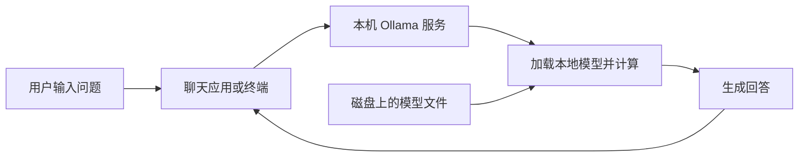

# Ollama：本地模型运行、模型管理与云端调用

> [!summary] 一句话解释
> Ollama 是帮助你获取、管理和运行大模型，并提供调用接口的工具；它常用于本地推理，也支持云端模型，因此不能仅凭“用了 Ollama”判断模型在哪里计算。

Ollama 是产品名，不是需要展开的英文缩写，读音可近似记为“欧拉玛”。它与 Llama 模型家族不是同一个名称：Ollama 可以运行多种受支持的模型，并不只服务于 Llama。

## 一、先把模型和运行工具分开

生活类比：**模型文件像影片，Ollama 像负责加载、播放和管理影片的软件，电脑像播放设备。**这个类比只用于区分职责；模型回答时会进行计算，并非播放预先录好的答案。

| 对象 | 是什么 | 主要作用 |
| --- | --- | --- |
| DeepSeek、Qwen、Llama 等模型家族 | 不同团队训练的模型；名称还可能指公司或服务 | 提供理解、生成等能力 |
| 模型权重 | 训练得到的大量参数，保存为文件 | 承载模型学到的数值规律 |
| Ollama | 模型运行与管理工具及相关服务 | 获取、加载、运行支持的模型，提供接口 |
| 聊天界面 | 输入问题、展示答案的交互层 | 方便人使用模型 |
| 你的电脑或服务器 | 承担计算与存储的设备 | 提供硬盘、内存和处理器资源 |

所以，“装好 Ollama”与“已经下载并运行某个本地模型”是不同步骤。具体能跑哪些版本，取决于 Ollama 的支持、模型格式和硬件条件。

## 二、它实际替你做什么

主要可以从三个角度理解：

1. **模型管理**：获取模型、查看已有模型，按名称选择使用。
2. **运行推理**：把模型加载到内存或显存中，用计算设备生成回答。
3. **提供接口**：让聊天应用、脚本或其他软件发送问题并取得结果。

**Inference（推理）**是使用已有参数进行计算。**Training（训练）**是利用数据反复调整参数。下载安装一个模型然后提问，通常是在推理，不是从零训练。

Ollama 提供应用与终端使用方式，支持 Windows、macOS 和 Linux。功能、模型和运行环境会更新，具体以对应平台文档为准。[Ollama 快速入门](https://docs.ollama.com/quickstart)

## 三、本地运行的大致过程



首次获取模型通常需要联网下载文件；文件准备好之后，**本地模型推理本身可以在离线环境中进行**。外部网页搜索、在线工具等功能仍然需要相应网络服务。

运行时常见的资源分工是：

- **硬盘**：保存下载好的模型文件。
- **RAM（Random Access Memory，随机存取存储器，通常简称内存）**：存放程序运行时的数据。
- **GPU（Graphics Processing Unit，图形处理器，逐字母读 G-P-U）及显存**：在支持的设备上承担模型计算并存放相关数据。
- **CPU（Central Processing Unit，中央处理器，逐字母读 C-P-U）**：也可以参与模型推理；具体速度取决于硬件和模型。

Ollama 可以有 CPU、GPU 或混合加载情况。`ollama ps` 可以用于查看当前加载的模型及处理器分配。[Ollama 常见问题](https://docs.ollama.com/faq)

## 四、为什么装了它仍可能跑不动模型

Ollama 简化使用步骤，但不会凭空增加硬件资源。至少要区分：

| 因素 | 对运行的影响 |
| --- | --- |
| 模型参数量和结构 | 影响权重规模与计算量 |
| 权重的数值精度或量化方式 | 影响存储、运行资源以及可能的质量损失 |
| 上下文长度 | 处理更多文字时可能需要更多缓存 |
| 同时处理的请求数 | 多路请求会竞争计算与内存资源 |
| 设备、驱动和推理后端 | 影响能否使用加速以及实际速度 |

**模型文件有多大，不等于运行只需同样大小的内存。**还要留出运行过程、缓存和其他程序的空间。不能仅凭“电脑有 16 GB 内存”就保证任意模型都能流畅运行。

**Quantization（量化）**可以粗略理解为用更少位数表示数值，节省空间，但可能改变质量。较小模型或更低精度通常更容易加载，是否满足实际任务仍需验证。

延伸阅读：[[GPU、显存与CUDA并行计算]]、[[大模型推理加速：FP8、量化、KV Cache与多Token预测]]、[[OOM：内存不足、显存不足与内存泄漏]]。

## 五、装在本机，就一定没有数据外发吗

**不一定。需要看实际选用的模型与整条调用路径。**当前 Ollama 同时提供本地与云端模型能力。[Ollama Cloud](https://docs.ollama.com/cloud)

| 使用方式 | 模型在哪里计算 | 提交给模型的内容是否离开本机 |
| --- | --- | --- |
| 本机 Ollama + 已下载的本地模型 | 本机 | 不需要为了该次模型计算而外发 |
| 你的电脑连接内网服务器上的 Ollama | 那台内网服务器 | 会离开你的电脑，但可仍在内网 |
| Ollama 调用云端模型 | 云服务商服务器 | 会发送给云端服务 |
| 本地模型 + 外部搜索或其他在线工具 | 模型在本地，部分工具在外部 | 工具请求中的内容可能外发 |

特别容易混淆的是：**请求地址为 `localhost` 只说明第一跳到了本机，不保证后续推理也在本机。**Ollama 的本地服务可以代为调用云端模型，官方认证文档给出了这类用法。[认证与云端调用说明](https://docs.ollama.com/api/authentication)

官方还提供关闭 Ollama 云功能的配置，例如 `OLLAMA_NO_CLOUD=1`，修改后需要重启。这个设置针对 Ollama 自身的云功能，不替代其他应用和工具的网络控制；需要离线环境时，应一起检查模型选择和外部依赖。[Ollama 本地模式说明](https://docs.ollama.com/faq#how-do-i-disable-ollamas-cloud-features)

关联：[[内网、公网与私有化服务器部署]]、[[大模型从数据、Token到训练与本地部署]]。

## 六、API 与 localhost、11434 是什么

**API = Application Programming Interface，应用程序编程接口，逐字母读 A-P-I。**可以把它理解为软件之间约定好的“点单窗口”。

Ollama 的本地接口常见地址是：

```text
http://localhost:11434/api/chat
```

- `http`：使用的通信协议。
- `localhost`：当前调用程序所在的本机环境。
- `11434`：Ollama 默认使用的端口，相当于这项服务的窗口编号。
- `/api/chat`：用于聊天的接口路径。

例如，你写一个笔记问答程序，程序可以把问题发送给这个接口，再把回答显示出来。是否保留历史、读取什么文档、调用什么工具，由应用和模型能力共同决定。

如果应用运行在另一台电脑或独立的容器网络中，它的 `localhost` 不一定指向运行 Ollama 的那台主机。部署时必须分清“从谁的环境访问谁”。

本地 API 默认不要求身份认证；若要让其他设备访问，需要同时设计访问范围、认证和网络限制，不能把“有接口”当成“已经可以安全公开”。[Ollama API 地址说明](https://docs.ollama.com/api/introduction)、[认证说明](https://docs.ollama.com/api/authentication)

关联：[[SDK与API]]、[[系统代理、VPN与端口]]、[[防火墙与端口对外开放]]。

## 七、一个命令例子：实际在做什么

以下仅为理解用的示例，前提是已经安装并启动 Ollama。此次整理笔记没有安装软件或下载模型。

**CLI = Command-Line Interface，命令行界面，逐字母读 C-L-I。**就是在终端输入文字命令操作程序。

```powershell
ollama run qwen3:0.6b
```

这条命令选择官方模型库中的 `qwen3:0.6b` 标签并启动交互；本地缺少所需文件时，会先获取模型。它不是训练命令，也不是购买 Token 的命令。这个标签是为了说明语法，不代表“当前最新”或“最适合所有任务”的型号。[该模型的官方条目](https://ollama.com/library/qwen3:0.6b)

常见管理命令可以这样理解：

| 命令示例 | 含义 |
| --- | --- |
| `ollama pull qwen3:0.6b` | 获取模型文件 |
| `ollama run qwen3:0.6b` | 使用这个模型交互 |
| `ollama ls` | 列出已有模型条目 |
| `ollama ps` | 查看当前加载运行的模型 |
| `ollama stop qwen3:0.6b` | 停止模型运行并卸载，不等于删除磁盘文件 |

命令形式依据 [Ollama CLI 文档](https://docs.ollama.com/cli)。在 Windows 中可以使用 PowerShell 或 CMD；运行服务并不是必须先装 Linux 或 Docker。[Windows 官方说明](https://docs.ollama.com/windows)

## 八、和知识库、Agent、聊天产品是什么关系

**Agent（智能体）**通常包含围绕目标运行的模型、工具、状态和控制流程。Ollama 可以成为它的模型供应端，但安装 Ollama 不会自动让模型读取你的全部文件或完成业务流程。

**RAG = Retrieval-Augmented Generation，检索增强生成，通常读作“rag”。**如果想让模型回答 Obsidian 中的笔记内容，还需要应用负责读取、切分、检索资料，再把相关片段交给模型。

```text
用户提问 → 知识库应用找相关笔记 → Ollama 调用所选模型 → 返回答案
```

因此，本地问答可能组合为“笔记 + 检索程序 + Ollama + 本地模型”。如果检索、嵌入或其他环节使用外部服务，仍要另行判断数据流向。

ChatGPT 这类聊天产品提供面向用户的完整使用体验；Ollama 更侧重模型运行、管理和接入。给 Ollama 接上聊天界面可以形成聊天应用，但界面相似不意味着底层模型、工具、联网能力和回答质量相同。

关联：[[RAG、Naive RAG与GraphRAG]]、[[Dify：可视化AI应用、知识库与工作流平台]]、[[Agent Harness：模型之外的运行系统]]。

2026-10-31 延伸：[[rLLM与vLLM：强化学习训练和模型推理的区别]]，把 Ollama 的模型管理与运行、vLLM 的高效推理服务、rLLM 的训练流程放在一起比较。进一步阅读 [[rLLM与vLLM：强化学习训练和模型推理的区别#vLLM 与 Ollama：具体区别与选型|vLLM 与 Ollama 的具体区别、选型与迁移准备]]，按 Windows 学习、个人知识库、持续并发、批量任务和多设备部署判断。

## 九、常见误区与学习建议

- **“Ollama 就是一个大模型。”**它运行和管理模型，回答能力取决于所选模型及应用。
- **“本地部署必须自己训练。”**通常可以运行别人训练好的开放权重，前提是格式、许可和硬件满足要求。
- **“装好以后就能运行任何模型。”**还受模型支持、格式和设备资源限制。
- **“安装 Ollama 就把知识库喂给模型了。”**笔记需要由应用明确读取与组织；聊天也不等于持续训练权重。
- **“本地推理不消耗 Token。”**仍会处理 Token，只是本地计算通常不需要按这次输入输出向云模型服务付费；硬件、耗电等成本仍然存在，云模式另有服务规则。
- **“模型文件下载完就不占内存。”**存放文件与运行加载是两回事，停止运行也不等于删掉模型文件。

初学者先分清“运行工具、模型文件、聊天界面、计算设备”四层，再学一次本地请求怎样完成。能解释模型在哪里算、资料发送到哪里，比先记住大量配置参数更有用。

## 参考资料

核对日期：2026-10-31。只解释原理与示例，未在本机安装、运行或测试 Ollama；没有核查本机适合运行哪些模型。具体模型和平台支持以实际版本为准。

- [Ollama Quickstart](https://docs.ollama.com/quickstart)
- [Ollama Cloud](https://docs.ollama.com/cloud)
- [Ollama FAQ](https://docs.ollama.com/faq)
- [Ollama API Introduction](https://docs.ollama.com/api/introduction)
- [Ollama Authentication](https://docs.ollama.com/api/authentication)
- [Ollama CLI Reference](https://docs.ollama.com/cli)
- [Ollama Windows](https://docs.ollama.com/windows)
- [模型语法示例：qwen3:0.6b](https://ollama.com/library/qwen3:0.6b)
