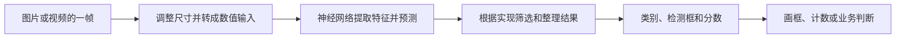

# YOLO：目标检测与智能体执行模式辨析

> [!summary] 一句话解释
> YOLO 在计算机视觉里是一类擅长快速找出物体类别和位置的目标检测模型；在智能体编程工具里，YOLO 模式通常是减少确认、放开某些执行限制的叫法，两者不是同一项技术。

YOLO 通常读作“优洛”。先看它出现在哪里：

| 出现场景 | 英文展开或含义 | 主要在讨论什么 |
| --- | --- | --- |
| 图片、摄像头、识别人车、画检测框 | You Only Look Once，只看一次 | 视觉模型怎样找出物体 |
| 编程助手、终端参数、自动执行 | 借用 You Only Live Once，人生只有一次 | 工具执行时的确认与权限设置 |
| 普通聊天、生活口号 | You Only Live Once | 一种生活态度，不必理解成技术 |

## 一、视觉 YOLO 解决什么问题

**Object Detection（目标检测）同时回答“是什么”和“在哪里”。**

想象你在仓库里看一张照片：你不仅说“照片里有瓶子”，还用笔把每一个瓶子圈出来。YOLO 的典型输出就是这些目标的类别、位置和分数。

下面是假设的输出，不是真实模型测试结果：

| 目标 | 类别 | 检测框：左上角到右下角 | 置信度分数 |
| --- | --- | --- | --- |
| 1 | 人 | `(100, 60) → (250, 380)` | 0.93 |
| 2 | 瓶子 | `(310, 180) → (350, 290)` | 0.86 |

- **Class（类别）**：模型判断它属于哪种物体。
- **Bounding Box（边界框，也叫检测框）**：框住目标的矩形。以上坐标是示意的像素坐标。
- **Confidence Score（置信度分数）**：帮助判断、筛选预测的分数。0.93 不等于系统在所有环境下都保证有 93% 的正确率。

模型通常返回数值结果，程序再把框和文字画到图片上。检测框是一个矩形范围，不是物体每个像素的精确轮廓。[Ultralytics 目标检测说明](https://docs.ultralytics.com/tasks/detect/)

## 二、为什么叫“只看一次”

原始 YOLO 论文把目标检测设计成：**让一个神经网络对整张图片进行一次前向计算，同时预测多个目标的位置与类别。**它区别于先生成候选区域、再对区域进行分类等分阶段的检测路线。[YOLO 原始论文](https://arxiv.org/abs/1506.02640)

“前向计算”可以理解为：输入数字经过已经训练好的网络，产生预测结果。

“一次”不表示只做一次加法、只训练一张图片，或整段视频只处理一帧。网络内部仍有很多层计算，视频需要持续处理不同画面。

不同 YOLO 版本的网络结构和结果处理方法会变化，不能把某一代的网格、锚框或去重步骤当成所有版本都固定采用的设计。这里解释的是共同思路，不做“最新版本”排名。

## 三、检测、分类、分割、跟踪有什么区别

| 任务 | 用瓶子举例 | 输出重点 |
| --- | --- | --- |
| 图像分类 Classification | 这张图属于“瓶子图片” | 整张图的类别 |
| 目标检测 Detection | 第一个瓶子在这里，第二个在那里 | 每个目标的类别和框 |
| 实例分割 Instance Segmentation | 分别涂出两个瓶子各自占据的像素 | 每个目标的轮廓或掩码 |
| 姿态估计 Pose Estimation | 找出人的肩、肘、膝等关键点 | 关键点位置 |
| 多目标跟踪 Tracking | 这一帧的瓶子和上一帧的是同一个 | 跨帧关联与目标编号 |

Ultralytics 的 YOLO 工具生态支持多种视觉任务，但通常要使用对应任务的模型与权重。不能把“框架支持分割”理解成随便加载一个检测模型就会输出精确轮廓。[Ultralytics 任务说明](https://docs.ultralytics.com/tasks/)

逐帧检测也不自动等于可靠跟踪。若要统计“经过传送带的独立瓶子数量”，还需要跨帧关联、过线规则等，否则同一瓶子可能被重复计数。

## 四、它怎样学会识别，用在哪里

用一个自定义包装瓶检测项目理解训练与推理：

1. **收集图片**：覆盖实际镜头下的角度、光线、遮挡和背景。
2. **标注样本**：在训练图片中框出瓶子，并写上类别。
3. **训练或微调**：让模型预测，比较预测与标注的差异，反复调整模型参数。
4. **独立验证**：用没有参与训练的图片检查漏检、误检和定位质量。
5. **部署推理**：把训练好的权重交给程序，对新的图片或视频进行检测。

预训练权重相当于已经学习过一批类别的模型。已有类别满足需求时可以先验证效果；要识别特定型号、特殊缺陷等，往往需要针对性数据和训练，不能只换一个文字标签就保证有效。

可应用于人车检测、物品定位、产线计数、机器人感知等。用在“质量检查”时还需要明确：要检测的是可见破损、缺件还是别的现象。看到瓶子不等于知道里面的成分或产品质量。

运行位置可以是本地电脑、服务器或 [[边缘计算模块与边缘网关|边缘设备]]。处理是否流畅取决于模型大小、图像分辨率、硬件和运行方式；实时性能需要在实际设备上测量。

## 五、它与大模型、Token 和 OOM 的关系

**LLM = Large Language Model，大语言模型，逐字母读 L-L-M。**常见聊天模型主要围绕语言生成开展工作；经典 YOLO 目标检测主要输出物体位置与类别，通常不需要像聊天一样逐字生成一篇回答。

[[多模态模型：ViT、DiT与视觉语言模型|视觉语言模型]]也能理解图片、回答问题，但与专门的目标检测器有不同的输出方式和工程取舍。也可以组合使用：检测器先找目标，其他模型或业务程序再分析。

本地运行 YOLO 会消耗内存、显存和计算资源，不能把一帧图像直接等同于某个固定的聊天 Token 数。图片、批量或模型变大时，也可能出现 [[OOM：内存不足、显存不足与内存泄漏|OOM（Out of Memory，内存不足）]]。

Ultralytics 的视频预测支持逐步产出结果；及时处理而不保存全部帧结果，可以减少结果堆积的内存，但不保证模型推理本身永远不会 OOM。[预测与流式处理说明](https://docs.ultralytics.com/modes/predict/)

## 六、智能体工具中的 YOLO 模式

编程工具中的 YOLO 借用了 **You Only Live Once（人生只有一次）**的口语意味，常用来称呼“让工具直接执行、少做确认”的模式。它不是统一的行业协议，各工具具体放开哪些限制，需要看文档。

生活类比：你请人整理仓库，“碰到某类操作先问我”是审批规则，“只能进入这一间房”是访问边界。两者可以分别设置。

- **Approval（审批或确认）**：执行某个操作前，是否需要批准。
- **Sandbox（沙箱）**：程序实际能访问哪些文件、网络等资源的限制环境。
- **自动审批审查**：由规则或审查系统判断某次操作，而不是直接取消所有限制。

### Codex 中的具体例子

2026-10-31 核对的 [OpenAI 官方权限文档](https://learn.chatgpt.com/docs/agent-approvals-security#common-sandbox-and-approval-combinations)将 `--yolo` 列为 `--dangerously-bypass-approvals-and-sandbox` 的别名：该选项跳过确认并绕过 Codex 自身的沙箱限制。

本机 `codex-cli 0.155.1` 的 `codex --help` 显示了上述长参数及对应行为。参数解释属于知识说明，不代表已经启用这种模式。

需要分清三个问题：

1. **不询问，不一定代表有权限。**例如保留只读沙箱同时设置不询问，受限操作仍可能失败。
2. **关闭工具自身沙箱，不等于获得系统管理员身份。**操作系统账户权限、外部容器和平台管理策略等仍可能限制操作。
3. **执行权限变化，不会自动改变模型能力。**它不会让模型更聪明、上下文更长或 Token 更便宜；允许执行的范围更大，也意味着错误操作可能影响更多资源。

因此，看见“开启 YOLO”时，首先确认它改变的是审批、沙箱还是其他限制。这属于 [[Agent Harness：模型之外的运行系统|智能体运行支撑系统]]的控制范围。

## 七、常见误区与学习建议

- **“YOLO 就是一种聊天大模型。”**视觉 YOLO 的经典任务是目标检测。
- **“只看一次，就是不用训练。”**名字描述检测思路，训练仍需数据与计算。
- **“能检测到人，就是知道这个人是谁。”**类别检测和身份识别是不同任务。
- **“所有叫 YOLO 的版本都有完全一样的实现。”**应核对具体项目、模型任务、权重和文档。
- **“YOLO 模式能让智能体保证做对。”**它调整执行控制，不提供正确性保证。

学习视觉部分时，先能说清“输入什么图片，输出哪些类别与坐标”，再区分分类、检测和分割；学习智能体部分时，先分清“模型想做什么、工具允许做什么、实际完成了什么”。

关联笔记：[[GPU、显存与CUDA并行计算]]、[[大模型从数据、Token到训练与本地部署]]、[[Agent评测：上下文成本、轨迹与独立验收]]。

## 参考资料

核对日期：2026-10-31。视觉原理以原始论文与 Ultralytics 官方文档为依据；执行模式以具体工具为例，不推断所有产品含义相同。表格中的检测结果和仓库类比是教学示例。

- [YOLO 原始论文：You Only Look Once](https://arxiv.org/abs/1506.02640)
- [Ultralytics：目标检测](https://docs.ultralytics.com/tasks/detect/)
- [Ultralytics：任务类型](https://docs.ultralytics.com/tasks/)
- [Ultralytics：预测与视频结果处理](https://docs.ultralytics.com/modes/predict/)
- [OpenAI：审批与沙箱组合](https://learn.chatgpt.com/docs/agent-approvals-security#common-sandbox-and-approval-combinations)
- 本机只读核对：`codex --version`、`codex --help`，版本为 `codex-cli 0.155.1`。
