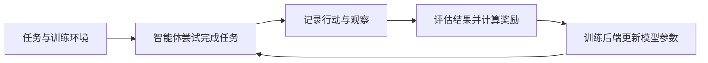

# rLLM与vLLM：强化学习训练和模型推理的区别

> [!summary] 一句话解释
> 本文的 rLLM 是通过强化学习训练智能体的开源框架；vLLM 是高效运行模型、提供推理服务的工具。前者主要关心怎样改进模型做事的能力，后者主要关心怎样高效地使用模型。

用户最初提供的名称是 `rllm`，随后选择先了解它与 `vLLM` 的区别。这里比较的是 `rllm-org/rllm` 与 `vllm-project/vllm`，不把所有同名项目当作同一件事。

读法可以按字母读：rLLM 为 R-L-L-M，vLLM 为 V-L-L-M。其中 **LLM = Large Language Model，大语言模型**。不要仅靠首字母猜项目职责，应结合项目地址和官方说明。

## 一、先分清训练、推理与服务

| 概念 | 在做什么 | 生活类比 |
| --- | --- | --- |
| Training，训练 | 根据数据、反馈等调整模型参数 | 培训客服，提高业务能力 |
| Inference，推理 | 使用已有参数处理输入并生成结果 | 客服利用已经掌握的知识回答问题 |
| Serving，推理服务 | 持续接收请求，调度资源并返回结果 | 安排坐席和排队，让许多客户得到服务 |

因此，模型“更会做题”与服务“每分钟能处理更多请求”是两个方向。提升其中一个，不代表另一个自然提升。

## 二、rLLM 是做什么的

**RL = Reinforcement Learning，强化学习，按字母读 R-L。**它利用奖励等反馈信号来学习更好的行为策略。

rLLM 将智能体执行任务、记录过程、评价结果与训练更新组织起来。它与 Berkeley Sky Computing Lab 有关，官方定位是用于训练语言智能体的开源框架。[官方介绍](https://docs.rllm-project.com/)、[实验室项目页](https://sky.cs.berkeley.edu/project/rllm/)

生活类比：rLLM 像一套培训系统，安排练习、记录学员如何操作、根据规则评分，再把反馈用于后续训练。

### 它怎样工作



这里的几个词可以这样理解：

- **Agent（智能体）**：围绕任务选择行动、使用工具并根据反馈继续工作的软件系统。
- **Environment（环境）**：智能体行动的对象，例如一个练习用订单系统、网页或代码项目。
- **Trajectory（轨迹）**：一次尝试中做了什么、得到哪些结果的过程记录。
- **Reward（奖励）**：把任务结果转成训练可以使用的评分信号，不是现实里的金钱奖励。
- **Training Backend（训练后端）**：实际执行参数优化等工作的组件或服务。

官方仓库描述的核心链路是“运行智能体、收集轨迹、计算奖励、更新模型”。rLLM 协调这些部分，底层训练计算可以交给适配的后端。[rLLM 官方仓库](https://github.com/rllm-org/rllm/blob/main/README.md)

### 用客服任务举例

假设训练任务是：“查询订单 123 的发货时间”。训练用系统保存了预设的订单数据：

1. 智能体决定是否调用订单查询工具。
2. 工具返回训练环境中的订单状态。
3. 智能体生成回答。
4. 评价程序检查是否查询了正确订单、回答是否符合工具结果。
5. 训练算法利用这些评分与轨迹调整模型参数，再进行后续练习。

以上是教学示例，不是 rLLM 内置的固定客服流程。实际任务需要开发者设计环境、数据、评分与验收。

**收集日志或重复提问，不等于已经训练了模型。**只有实际发生了对应的训练更新，才涉及这种参数学习。普通模型调用权限也不等于有权更新服务商模型参数；需要能够训练的模型和后端。

奖励设计还可能出错：如果只奖励“回答看起来很完整”，模型可能学会编造细节。训练效果要用独立样本验证，确定性的业务权限与约束仍要由系统落实。

## 三、vLLM 是做什么的

vLLM 是面向模型推理和服务的软件，帮助应用高效运行受支持的模型。它可以用于批量生成，也可以持续接收应用请求、返回模型输出。[vLLM 官方文档](https://docs.vllm.ai/en/latest/)

生活类比：模型像已经培训好的客服，vLLM 更像坐席调度与服务系统，安排有限资源处理多位客户的请求。

沿用同一个客服系统：模型已经能够查询订单并生成回答，但同时有很多用户提问。此时需要关心：

- 请求怎样排队、组成计算批次；
- 模型和生成缓存怎样使用显存；
- 一个请求完成后，怎样继续处理新请求；
- 怎样把模型输出返回给应用。

**GPU = Graphics Processing Unit，图形处理器，逐字母读 G-P-U。**模型计算可以利用 GPU 等受支持的设备；性能取决于模型、硬件、精度、请求长度和部署配置。

### 连续批处理：让正在运行的批次持续接纳新请求

**Continuous Batching（连续批处理）**可以粗略理解为：多个请求一起参与一轮轮生成，短请求完成后退出，新请求可以在调度时加入。

假设请求 A 只需生成很短的回答，B 需要长答案，C 正在等待。动态调度可以在 A 完成后安排 C 加入，不必把所有请求都固定绑成一个必须一起结束的批次。

它的目标之一是提高 **Throughput（吞吐量）**，也就是单位时间处理的工作量，例如每秒生成多少 Token。**Token（词元，读音近似“偷肯”）**是模型处理内容的单位。

吞吐提高，不代表每位用户的等待时间都会按同样比例缩短；还要检查单次请求的延迟和排队情况。

### PagedAttention：更灵活地安排生成缓存

常见自回归模型生成文本时，会保存已处理内容的 **KV Cache（Key-Value Cache，键值缓存）**，避免重复计算一部分注意力中间结果。

**PagedAttention（分页注意力）**借鉴操作系统的分页思路，把这类缓存按块管理，允许逻辑上连续的数据存放在不同物理位置，减少碎片和过度预留造成的浪费。

可以类比仓库：不要求每个客户都预占一整条足够长的连续货架，而是按需分配小格子，再登记这些格子的位置。[原始论文](https://arxiv.org/abs/2309.06180)、[项目原始技术介绍](https://vllm.ai/blog/2023-06-20-vllm)

它优化缓存管理，不会让显存变成无限，也不等于删掉模型权重。长上下文、大模型和过高并发仍可能导致 [[OOM：内存不足、显存不足与内存泄漏|OOM（Out of Memory，内存不足）]]。

## 四、与 Ollama 放在一起比较

| 比较点 | rLLM：强化学习框架 | vLLM | Ollama |
| --- | --- | --- | --- |
| 主要定位 | 组织智能体评测与训练 | 高效模型推理与服务 | 模型获取、管理、运行与接入 |
| 典型问题 | 怎样让模型通过反馈改善任务表现 | 怎样高效处理许多模型请求 | 怎样方便地选择并用上一个模型 |
| 是否会训练更新参数 | 在执行训练流程时会；单独评测不会 | 常规推理服务不会自行训练 | 常规模型运行不会自行训练 |
| 典型使用者 | 做模型后训练与智能体研究的团队 | 建模型服务、做批量推理的开发者 | 本地使用者与接入模型的开发者 |
| 与硬件的关系 | 需要训练计算，可能由本地或远程后端承担 | 依赖设备与调度提高推理效率 | 简化使用流程，但本地模型仍受硬件限制 |

这些是主要侧重点，不是“某工具只能用于个人、另一工具只能用于公司”的硬边界。Ollama 也可以提供服务，vLLM 也可以运行在自己的机器上。具体适用性要按实际工作负载评估。

Ollama 还支持云端模型；使用哪种工具并不能单独决定数据是否出内网，必须看模型和工具的实际部署地址。详见 [[Ollama：本地模型运行、模型管理与云端调用]]。

## 五、rLLM 与 vLLM 可以一起用吗

可以。训练过程中，模型需要先尝试回答或行动，才能得到反馈。因此，训练系统内部也需要推理。

在兼容的配置下，可以形成这样的分工：

```text
rLLM 组织任务与训练流程
    ↓
推理组件（例如 vLLM）生成回答或行动
    ↓
环境执行，记录结果并评分
    ↓
训练后端更新模型参数
    ↓
把更新后的参数同步给推理侧，继续下一轮
```

rLLM 当前官方仓库的 `verl` 后端安装说明就提到了 vLLM/SGLang 组合。是否适配仍取决于后端、模型和版本；不能把它理解成任意两个服务填同一个地址就能完成训练。

**API = Application Programming Interface，应用程序编程接口，逐字母读 A-P-I。**一个服务提供兼容的推理接口，只代表可以按约定调用，不自动具备梯度更新、训练数据收集、参数同步等训练能力。

## 六、还有另一个同名 rLLM

`rllm-team/rllm` 中的 **rLLM（relationLLM）**是另一个项目，侧重 **RTL（Relational Table Learning，关系表学习）**：结合表格、关系图和语言模型等方法，从相互关联的数据中学习。

例如“用户表—订单表—商品表”之间通过关联字段连接，研究怎样利用这些结构做预测。这和本文的智能体强化学习框架不是同一个项目。[relationLLM 官方文档](https://relationllm.readthedocs.io/en/latest/)

看到 `rllm` 时，最好同时确认仓库组织名、文档网址和上下文。本节只是列出一个重要同名项目，不代表这个名称只有两种用法。

## 七、与已有知识怎样连接

- [[RLHF与大模型对齐]]：RLHF 是 Reinforcement Learning from Human Feedback，基于人类反馈的强化学习。rLLM 是框架，RLHF 是方法类别；rLLM 的奖励也可以来自程序测试等其他来源。
- [[Preset与Agent Trajectory]]：任务中的真实行动与工具结果，如何组织成可分析的轨迹。
- [[Agent Harness：模型之外的运行系统]]：运行智能体需要哪些工具、状态和权限支撑。
- [[Agent评测：上下文成本、轨迹与独立验收]]：训练评分之外，还需要独立评测确认改进是否有效。
- [[大模型推理加速：FP8、量化、KV Cache与多Token预测]]：把 vLLM 放到批处理、缓存和并行计算的整体框架里理解。
- [[高并发系统：瓶颈分析、扩容与稳定性治理]]：模型服务只是应用的一部分，数据库、业务工具和网络仍可能成为瓶颈。

## 八、常见误区与学习建议

- **“rLLM 与 vLLM 是同一个工具的不同版本。”**它们是不同项目，主要职责不同。
- **“用了 rLLM，智能体就会自动越聊越聪明。”**需要实际训练流程、奖励、数据与可训练的后端。
- **“vLLM 会让模型更懂业务。”**推理效率优化本身不会自动加入业务知识或训练能力。
- **“吞吐更高，就一定每次回答都更快。”**需要同时比较吞吐、首个输出等待时间和整体延迟。
- **“这些工具能无限增加上下文与并发。”**模型能力、缓存、硬件容量和调度都有边界。

初学者先掌握训练和推理的区别，再阅读 [[Ollama：本地模型运行、模型管理与云端调用]]。理解多人使用模型时的资源问题后，再深入 vLLM；需要设计奖励并训练模型时，再深入 rLLM。研究框架前先判断实际问题属于能力、知识、流程还是性能。

## 参考资料

核对日期：2026-10-31。本文是原理与职责比较，没有进行软件安装、模型训练或性能测试。客服与仓库场景均为教学示例，不是项目基准结果。

- [rLLM 当前官方文档](https://docs.rllm-project.com/)
- [rLLM 官方仓库 README](https://github.com/rllm-org/rllm/blob/main/README.md)
- [rLLM 训练循环](https://docs.rllm-project.com/core-concepts/training)
- [Berkeley Sky Computing Lab：rLLM](https://sky.cs.berkeley.edu/project/rllm/)
- [vLLM 官方文档](https://docs.vllm.ai/en/latest/)
- [Efficient Memory Management for Large Language Model Serving with PagedAttention](https://arxiv.org/abs/2309.06180)
- [vLLM 原始技术介绍](https://vllm.ai/blog/2023-06-20-vllm)
- [relationLLM 同名项目文档](https://relationllm.readthedocs.io/en/latest/)
