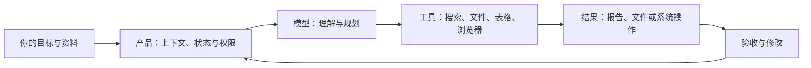

# AI办公智能体对比：QoderWork、千问办公、WorkBuddy、Muse、dot与Manus

> [!summary] 一句话结论
> **你列的这些产品大多属于“能调用工具、处理多步骤任务的 AI 助手”，差别主要在执行环境、连接的资料、持续工作方式和交付物。**比较时先看它实际能替你完成哪段工作，再看用了哪个模型。

完整目录见 [[AI产品全景清单：办公、智能体、编程、研究与创作]]。本篇核对日期为 **2026-11-15**，属于公开资料对比，未进行六款产品的同条件性能测试。

## 一、先把名字认准

| 你写的名字 | 本次查到的对应产品 | 是否仍有歧义 |
|---|---|---|
| QuWork | 未找到足够可靠的同名官方产品；候选为 QoderWork、QwenWork | **仍待原链接确认**，不能强行替你改名 |
| workbuddy | 腾讯 WorkBuddy | 已确认 |
| muse | Meta Muse 个人智能体 | 本篇按此版本整理；Muse 还有其他同名语境 |
| dot | OpenAI 的 dot/dots | 本篇按此版本整理；不是图形语言 DOT 或其他同名应用 |
| manus | Manus 通用任务智能体 | 已确认 |
| 千问办公 | QwenWork，阿里巴巴/钉钉体系的办公平台 | 已确认；与普通千问聊天应用不同 |

QoderWork 可近似读“扣德 Work”，WorkBuddy 是“工作伙伴”，Muse 读“缪斯”，dot 读“多特”，Manus 常近似读“马努斯”。这些是产品名，读音不决定产品的技术类别。

## 二、用同一件事理解它们

假设你说：“把这个文件夹里的课程反馈和报名表整理一下，找出常见问题，做一份汇报。”

可能涉及：

1. 找到文件，并确认哪些文件允许读取。
2. 识别表头、日期、重复记录和缺失项。
3. 统计报名数，归纳反馈，保存计算依据。
4. 查必要资料，注明来源和日期。
5. 生成报告、表格或演示文稿。
6. 根据你的修改意见继续调整。
7. 如果要求定期更新，再保存任务规则与日程。

模型负责理解与生成，产品的工具和运行系统负责访问文件、计算、排版、存储状态和执行动作。它们的区别往往体现在这些步骤，而不只体现在聊天回答质量。

基础概念见 [[Agent Harness：模型之外的运行系统]]、[[MCP模型上下文协议]]、[[SDK与API]]。

## 三、六个重点产品逐个看

### 1. QoderWork：从编程 Agent 延伸到日常桌面工作

官方文档将 QoderWork 定位为桌面工作助手，能力包括文件处理、浏览器自动化、电脑操作、定时任务以及消息渠道和技能扩展。可把它理解为围绕你授权的电脑资料执行任务的工作台。[QoderWork 官方简介](https://docs.qoder.com/zh/qoderwork/introduction)

文件操作在本地完成，不代表文本完全不出设备；官方说明相关文本会送往模型 API 服务商用于理解和分析。因此“本地桌面应用”与“本地大模型推理”应分别检查。[官方数据说明](https://docs.qoder.com/zh/qoderwork/introduction)

**当前状态：QoderWork CN 公告计划于 2027-09-05 停止运营，此前仍可使用，并建议迁移至 Qoder CN 桌面版。**认识旧产品时保留这个名字；今天准备投入大量工作时，先看新入口和迁移方案。此公告不能直接外推所有国际版本。[CN 官方调整说明](https://qoder.cn/download?product=qoderwork)

教学试用：给一个复制出来的课程资料文件夹，让它生成文件清单和分类建议，再检查是否保留原文件、是否能解释分类依据。

### 2. 千问办公 QwenWork：围绕办公成果与钉钉生态

千问办公是阿里巴巴的一站式 AI 办公平台，官方重点包括文档、表格、演示、网页等产物，以及桌面、网页与钉钉相关入口。它强调把模型能力接进实际办公流程。[千问办公官方简介](https://docs.qwenwork.cn/product-introduction)

适合评估的场景包括课件、业务汇报、数据分析和企业资料协作。判断时应看现有资料是不是已经在它方便连接的位置，以及个人版与企业版的权限管理是否匹配需要。

“千问”是应用品牌，“Qwen”也是模型系列的名称，“千问办公”则是特定办公产品。会调用千问模型的软件，不一定就是官方千问办公。具体服务主体在其协议中说明。[千问办公服务协议](https://terms.alicdn.com/legal-agreement/terms/b_end_product_protocol/20260708175856831/20260708175856831.html)

### 3. WorkBuddy：腾讯的综合办公工作台

腾讯官方将 WorkBuddy 定位为全场景 AI 办公工作台，覆盖办公、代码和设计创意；它可以拆解任务、调用工具，并处理授权的本地文件，也有云端文件处理场景。[腾讯云 WorkBuddy 产品页](https://cloud.tencent.com/product/workbuddy)

它与 CodeBuddy 名字接近：CodeBuddy 的主要产品定位是开发编程，WorkBuddy 更偏综合工作场景。两者能力可以重叠，但不能因为都能写代码就当成同一个入口。

企业还存在 WorkBuddy Enterprise 产品体系，官方列出编码、办公与托管运行等方向；个人账号看到的能力不应直接当作企业版权限或部署承诺。[WorkBuddy Enterprise](https://cloud.tencent.com/product/workbuddy-enterprise)

教学试用：把同一份脱敏报名表和课程反馈交给它，检查统计结果、引用依据和生成文件能否继续编辑；若团队主要使用腾讯会议，再检查连接会议资料的流程。

### 4. Muse：Meta 的个人任务智能体

Meta 官方介绍的 Muse 有独立的虚拟计算机和浏览器，可以在用户授权下跨应用处理任务，并在用户离开应用后继续推进较长的工作。它更偏个人目标、日常事务与持续协助。[Meta Muse 发布说明](https://about.fb.com/news/2026/09/introducing-muse-personal-ai-agent/)

官网列举邮件、日历、预约和个人计划等场景，并提供手机、桌面和 WhatsApp 等交互说明。这里描述的是产品定位，实际可用渠道与地区以当前账户为准。[Muse 官网](https://muse.ai/)

Muse 产品与为它提供能力的模型不是同一个层次。不要因“有一台云端电脑”就推断它自动拥有你本机文件、邮箱或企业系统的权限；这些需要分别连接和授权。

### 5. dot：OpenAI 的常驻智能体

OpenAI 官方将 dots 描述为拥有独立云端电脑、可持续工作的智能体，能够使用连接的应用，记住协作偏好，并通过 ChatGPT、Slack、Teams 等渠道协作。它也可以在授权后连接其他设备。[OpenAI dots 官方介绍](https://openai.com/index/introducing-dots/)

可用“持续跟进一个项目”理解其定位：除了本次回答，还需要保留任务上下文、收集变化、产出结果并在需要决定时与你交互。公开发布说明包含套餐与地区开放条件，不能从有 ChatGPT 账号就推导出一定能使用 dot。

dot、ChatGPT 和 Codex 有产品关系，但不宜互相等同：前者偏常驻委派，ChatGPT 包含对话与工作入口，Codex 更突出工程开发；具体能力可以交叉。[ChatGPT 产品概览](https://chatgpt.com/overview/)、[Codex 产品页](https://openai.com/codex/)

### 6. Manus：按任务交付研究和制作成果

Manus 官方当前提供研究、幻灯片、网站、设计、视频等入口，也列出桌面与移动入口。它适合用“把一个目标交给智能体，最后拿到可检查的成果”来理解。[Manus 官网](https://manus.im/)

教学试用可以是：“调研十个课程平台，按统一字段记录官方来源，输出比较表和总结。”验收应检查十个对象是否真实、字段是否统一、引用是否支持结论、成果能否导出。

不能只凭“有桌面 App”就判断全部任务在本机执行，也不能用网上的一次演示推断复杂任务成功率。比较其当前版本时，把执行环境、资料连接和计费口径逐项记录。

## 四、它们到底有什么区别

下面是依据公开定位做的归纳，不是互斥功能清单，也不是成绩排名：

| 比较维度 | 更值得先查看的产品 | 为什么先看 |
|---|---|---|
| 本地文件与桌面任务 | WorkBuddy、QoderWork/当前 Qoder、阶跃桌面伙伴 | 官方明确介绍文件/桌面操作；仍要看实际支持范围 |
| 钉钉与企业办公资料 | 千问办公 | 产品强调与钉钉及办公流程结合 |
| 腾讯生态协作 | WorkBuddy | 与腾讯办公产品和企业体系有对应入口 |
| 长期个人目标与跨应用事务 | Muse、dot、Gemini Spark | 官方强调持续工作、个人上下文或任务计划 |
| 研究、演示、网页等成品 | Manus、Genspark、Skywork、千问办公 | 产品把多步骤成果作为主要入口 |
| 已有代码仓库和开发工作 | Codex、Claude Code、Cursor、Qoder | 工程上下文、代码修改与验证是核心场景 |
| 自己部署和改造助手 | OpenClaw、Hermes Agent、DeepSeek Harness | 需要更多配置和维护，可按自己的环境组织能力 |

这里的“先查看”是试用候选，并不表示别的产品做不了。更多官方依据与入口在 [[AI产品全景清单：办公、智能体、编程、研究与创作]]。

## 五、为什么“能用电脑”不等于“全自动把任何事做完”

“用电脑”可能指不同实现：

- **调用接口**：直接请求日历、云盘或业务系统，通常比点击界面更容易拿到结构化结果。
- **运行代码**：用脚本计算表格、转换文件、生成图表。
- **操作网页**：打开浏览器、读取页面、填写表单。
- **操作桌面**：通过控件信息或屏幕图像点击、输入。
- **在独立环境工作**：在云端电脑中处理任务，必要时才连接你的本机。

产品可能组合多种方式。因此，要分别问“能看到哪些资料”“能做哪些动作”“结果保存在哪里”“我能否追溯和撤销”。不能把一张结果截图当成所有步骤都已成功的证据。详见 [[RPA、UI Automation与CDP]]、[[Agent评测：上下文成本、轨迹与独立验收]]。

## 六、用一个小任务做公平对比

选择同一份脱敏资料，让候选产品完成同一任务，避免每款试不同题目：

> 根据提供的课程反馈与报名数据，整理三类常见问题，核对报名人数，生成一份报告和一张汇总表；注明资料来源、计算方法和无法确定的地方，保留原文件。

| 检查项 | 怎样算通过 |
|---|---|
| 理解目标 | 交付报告和汇总表，字段、范围和格式符合要求 |
| 数据正确 | 报名人数、去重规则、分组总数可重新算出 |
| 事实依据 | 不编造缺失内容；引用指向真正支持结论的位置 |
| 文件可用 | 能打开、编辑和导出，版式没有明显损坏 |
| 修改能力 | 改一个统计口径后，相关表格与结论一起更新 |
| 权限边界 | 只访问被授权资料，操作可追踪 |
| 成本 | 记录本任务的实际额度、总耗时和人工返工时间 |
| 可迁移性 | 文件、资料与任务记录能否带走 |

对你来说，稳定完成“查资料—做笔记—整理文件—提交 Git”或“做课件—核对数据—交付报告”的实际流程，更便于判断价值。

## 七、怎样继续学习

1. 先从全景清单认识类别，再挑与你当前任务相关的两三款。
2. 了解 [[大模型从数据、Token到训练与本地部署]]，区分产品、模型和数据路径。
3. 看 [[Agent Harness：模型之外的运行系统]]，理解为何同一模型装进不同产品会有差异。
4. 如果想自己做工作流，看 [[Coze扣子：智能体搭建、工作流与平台测试]]、[[Dify：可视化AI应用、知识库与工作流平台]]。
5. 用 [[Agent评测：上下文成本、轨迹与独立验收]] 的思路保留任务证据，避免只凭宣传选择。

## 资料与核实边界

产品事实的主要官方来源已就近链接，核对日期为 2026-11-15。试用任务、比较维度和学习顺序是本笔记的整理建议。未回答的 QuWork 名称问题仍保持待确认；没有据此新增一个虚构产品。

当前公开页面存在更新不同步的情况；遇到旧介绍与现行下载/迁移公告不同，优先记录新公告，并保留地区、套餐与版本范围。
