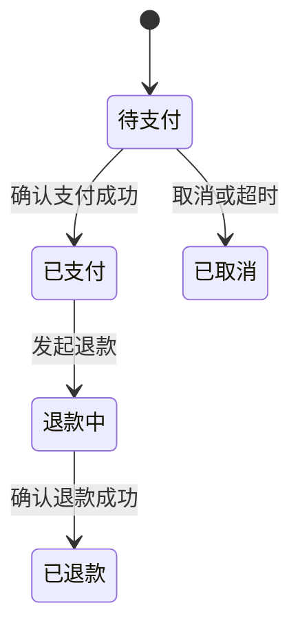

# 测试用例设计：等价类、边界值、判定表与状态迁移

## 一句话解释与类比

**用例设计是在无法穷尽所有输入的情况下，有依据地挑选更可能暴露问题的场景，并写出明确预期。**像检查桥梁：除了正常通车，还要选择不同载荷、边界和组合，不能让同一辆空车来回通过就宣称全面验收。

先澄清规则，再设计测试。金额是否允许零、密码按字符还是字节计数、日期按哪个时区判断，都不是测试者凭感觉决定的。

## 一、等价类：把“预期处理方式相似”的输入分组

教学规则：购买数量必须是整数且为 1～10。

| 类别 | 代表输入 | 预期 |
|---|---|---|
| 有效整数 | 5 | 接受 |
| 小于下限 | -3 | 拒绝，不写入订单 |
| 大于上限 | 20 | 拒绝 |
| 非整数 | 2.5 | 拒绝，不能静默截断 |
| 类型不符 | "abc"、数组 | 参数类型错误 |
| 缺失/空 | 未传字段、null、空字符串 | 按契约拒绝或使用明确定义的默认值 |

等价不是说内部代码一定完全相同，而是基于规格把输入划为期望行为类似的组。代表值只降低成本，不能保证组内所有值都安全。

无效类别通常先分别测试，避免同时传错账号、数量和金额，结果只触发账号错误，其他检查根本没执行。

## 二、边界值：为什么特别关注边缘

常见实现错误是把 `<=` 写成 `<`，或截取字符串多/少一位。对整数闭区间 1～10，可检查 0、1、2、9、10、11。不同边界覆盖准则选点不同，这组六点是易理解的练习，不是所有系统固定规定。

| 对象 | 容易忽略的边界 |
|---|---|
| 文本 | 空、1 个字符、最大长度、超长；中文、表情和组合字符 |
| 金额 | 0、最小货币单位、上限；精度、舍入和溢出 |
| 时间 | 开始前/恰好开始/结束时；跨日、闰日、时区 |
| 文件 | 空文件、最大大小、超限；扩展名与实际内容不一致 |
| 分页 | 无结果、最后一页、页码为零、重复翻页时新增数据 |

连续数值的“旁边”取决于允许精度，不能机械地用加减 1。例如按分计价的 10 元上限，应考虑 9.99、10.00、10.01。

## 三、判定表：多条件决定结果

教学规则：只有已购买且课程未过期才能观看。完整判定表为：

| 已购买 | 未过期 | 允许观看 |
|---|---|---|
| 是 | 是 | 是 |
| 是 | 否 | 否 |
| 否 | 是 | 否 |
| 否 | 否 | 否 |

判定表帮助防止把 AND（同时满足）误写为 OR（任一满足）。增加“管理员豁免”时应重新审查规则，而不是随便在旧表加一句备注。

**因果图**把输入条件作为原因、输出动作作为结果，用逻辑关系表达；再可转换为判定表。它适合规则交织的场景，不等于画普通操作流程图。互斥条件、无意义组合也要明确记录。

## 四、场景法：检查真正的用户路径

正常路径：登录 → 搜索课程 → 加入购物车 → 下单 → 查看订单。

再从节点引出备选/异常：未登录、课程下架、库存变化、优惠券失效、超时后重试、关闭页面后返回、另一台设备取消订单。

场景法擅长发现“每个接口单独正常，组合起来却有问题”。但只沿一条成功路径走通，不能代替参数、边界和权限检查。

## 五、状态迁移：测试的不只是当前值

需要检查：每个状态能否到达、合法转换能否发生、禁止转换是否被拒绝、重复事件和乱序事件如何处理。例：订单已取消后迟到的支付回调，可能需要记录支付并触发补偿，不能不看业务规则就直接丢弃。

覆盖一个状态不等于覆盖所有转换；覆盖全部单步转换也不等于覆盖所有多步路径。状态带循环时路径可能无限，需要按风险选路径长度和重点组合。关联 [[状态机与幂等性]]。

## 六、正交与两两组合：控制组合爆炸

浏览器 3 种 × 系统 3 种 × 网络 2 种 × 语言 2 种共有 36 种组合。资源不够时，可选择有覆盖目标的组合设计。

正交表强调均衡的试验设计；Pairwise（两两组合，近似读“佩尔外兹”）强调任意两个因素的取值组合被覆盖。两者有关联，但不是同义词；正交表也不能任意忽略条件和交互假设。

三个二值因素的教学例子：

| 用例 | 因素 A | 因素 B | 因素 C |
|---|---|---|---|
| 1 | 0 | 0 | 0 |
| 2 | 0 | 1 | 1 |
| 3 | 1 | 0 | 1 |
| 4 | 1 | 1 | 0 |

每一对因素都出现了 00、01、10、11，但三因素组合 111 没测试。如果缺陷恰好需要三条件同时成立，就会漏掉。高风险组合和最常用配置应另外加入。

## 七、错误推测、探索性与模糊测试

- **错误推测**：根据历史和机制提出风险假设，如“断网后重试可能重复扣减”。将猜测转成可复现用例，不能只凭直觉宣判。
- **探索性测试**：边学习边设计边执行。例：给自己 30 分钟，专门探索课程页的登录失效和返回操作，记录路径、发现和未查区域。
- **随机测试**：随机组合操作，适合暴露非预期顺序问题；必须记录种子、事件和环境以便复现。
- **Fuzzing（模糊测试，近似读‘法兹英’）**：自动生成或变异输入，观察崩溃、超时、断言失败等。可以使用覆盖反馈，远不止“随便生成乱码”。

## 八、四个练习怎样落实

| 业务 | 设计重点 | 除界面提示外还验证什么 |
|---|---|---|
| 登录 | 空值、错误密码、失效会话、频率限制 | 没有获得不应有的会话和权限 |
| 购物车 | 件数边界、库存变化、重复点击 | 总金额、库存、优惠计算一致 |
| 上传 | 大小边界、文件类型、重名、中断 | 文件权限、存储状态、失败后的残留 |
| 转账模拟 | 金额精度、余额不足、重复请求、并发 | 账本平衡、只记一笔、失败可追踪 |

练习转账使用隔离的模拟账本。每条用例写“前置—输入—操作—预期—证据”，不要执行真实支付来验证一个教学例子。

## 常见误区与学习建议

用例越多不必然覆盖越好；100 条相近的正常输入，可能不如一条认真设计的权限异常。覆盖率 100% 只说明某个定义下的覆盖，不说明需求正确或系统没有缺陷。

先用等价类和边界写数量校验，再用判定表写课程权限，最后用状态迁移写订单。完整管理流程见 [[测试流程与缺陷管理：从需求评审到发布报告]]，分类见 [[全量测试、回归测试与测试分层]]。

## 参考资料

核对日期：2026-11-15。表格和业务例子为原创教学设计。

- [ISTQB 基础级大纲第 4 章](https://istqb.org/wp-content/uploads/2024/11/ISTQB_CTFL_Syllabus_v4.0.1.pdf)：测试设计方法。
- [NIST 组合测试项目](https://csrc.nist.gov/projects/automated-combinatorial-testing-for-software)：组合覆盖与交互故障。
